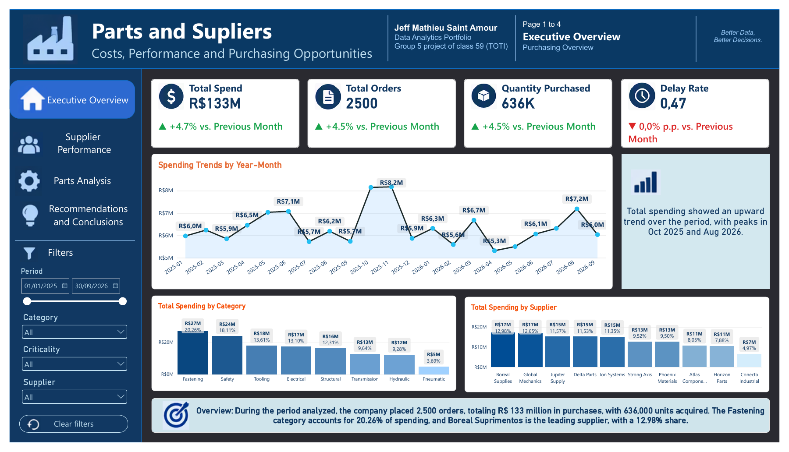

# Parts and Suppliers
### Procurement costs, supplier performance and purchasing opportunities

**SQL · Python · Pandas · NumPy · SQLite · Power BI · DAX**

A collaborative academic analytics project translating purchasing records and supplier quotes into a four-page decision-support report.

## Business problem

Procurement teams need to understand where spending is concentrated, which suppliers combine reliable delivery with acceptable quality, and which parts offer negotiation opportunities or expose the organization to limited supplier coverage. This project brings those questions into one analytical workflow.

The dataset is **synthetic**, created for academic demonstration. It does not describe an actual company's procurement operations.

## Scope and verified results

Full-period results from the final Power BI model, independently recalculated from its stored tables:

| Indicator | Result |
|---|---:|
| Order-date coverage | January 1, 2025 - September 30, 2026 |
| Purchase orders | 2,500 |
| Units purchased | 636,430 |
| Parts / categories / suppliers | 100 / 8 / 10 |
| Supplier quotes | 394 |
| Total spend | R$133,493,473.90 |
| Quantity-weighted unit price | R$209.75 |
| Late delivery rate | 47.40% of orders |
| Defect rate | 1.81% of purchased units |
| Parts with two or fewer quoted suppliers | 25 |
| Parts with relative quote gaps above 30% | 30 |
| Potential savings scenario | R$36,261,805.79 (27.16% of spend) |

Potential savings are a quote-based scenario, not achieved or guaranteed savings. The final measure sums nonnegative savings at part level. Definitions are documented in [Methodology](docs/METHODOLOGY.md).

## Findings and business interpretation

- **Spending concentration:** Fastening accounts for 20.26% of spend. Boreal Supplies is the largest supplier by spend, at 12.98%.
- **Negotiation opportunity:** Safety has the largest category-level savings scenario, R$8,974,791.39. Industrial Lock 093 leads individual parts at R$5,583,047.48.
- **Supply exposure:** 25 parts have at most two quoted suppliers. Coverage indicates a screening priority; it does not establish supplier capacity or continuity.
- **Delivery and quality:** Delta Parts has the highest late-delivery rate, 51.90%. Phoenix Materials has the highest defect rate, approximately 3.20%. Atlas Components combines the lowest delay rate, 39.59%, with a defect rate of approximately 0.82%.
- **Action segmentation:** 9 parts fall in the high-spend/high-gap quadrant; 21 in low-spend/high-gap; 46 in low-spend/low-gap; and 24 in high-spend/low-gap.

## Analytical workflow

1. **Prepared data:** the final PBIX tables establish the authoritative reporting snapshot of the academic dataset.
2. **Python validation:** identifiers, missing values, joins, dates, quantities, prices and line amounts are checked.
3. **SQLite analysis:** relational queries summarize spend, supplier performance, quote dispersion and supplier coverage.
4. **Pandas and NumPy:** part-level savings, decision quadrants and an explicitly weighted supplier score support interpretation.
5. **Power BI:** DAX measures and four report pages communicate the findings through coordinated views.

The professional notebook retains explanatory context and the purpose of each processing stage. It uses the final prepared inputs rather than regenerating the earlier random dataset. This preserves the supplied report's corrected monetary values.

## Report pages

| Page | Analytical purpose | Preview |
|---|---|---|
| Executive Overview | Spending trends, categories and suppliers | [View](assets/01_executive_overview.png) |
| Supplier Performance | Delivery, defects and supplier coverage | [View](assets/02_supplier_performance.png) |
| Parts Analysis | Spend, quote gaps, savings and dependency | [View](assets/03_parts_analysis.png) |
| Recommendations and Conclusions | Priority quadrants and action planning | [View](assets/04_recommendations.png) |

[View the four-page report PDF](powerbi/Parts_and_Suppliers_Report.pdf)

The PDF and images preserve the supplied report. Its delay cards display a decimal ratio (0.47); the table above expresses that measure as a percentage (47.40%). The bar chart on page 2 titled "Total Spend by Supplier" displays distinct part counts, not currency; its interpretation here is supplier coverage. Dynamic interactions require the private PBIX and are not available in the static export.

## Repository contents

- [Professional analysis notebook](notebooks/Parts_and_Suppliers_Analysis.ipynb)
- [SQL analysis](sql/analysis.sql)
- [Core DAX measures](powerbi/core_measures.dax)
- [Methodology and indicator definitions](docs/METHODOLOGY.md)
- [Data dictionary and relationships](docs/DATA_DICTIONARY.md)
- [Validation and source reconciliation](docs/VALIDATION.md)
- [Team credits](docs/CREDITS.md)
- [Data access statement](docs/DATA_ACCESS.md)

## Data source and access

The original notebook describes a reproducibly generated synthetic academic dataset. For this portfolio, the corrected tables stored in the supplied final Power BI model are the reporting source. The original generator produces a different monetary snapshot and is not used to reproduce the final dashboard.

Record-level inputs and the editable PBIX are excluded from this public package. Access to the prepared inputs may be considered upon request, subject to the participating team's agreement. The notebook includes executed aggregate outputs for methodological review. Its rerun requires the approved input files and the environment described in [REPRODUCIBILITY.md](docs/REPRODUCIBILITY.md).

## Project team and attribution

This portfolio presents a collaborative academic project developed for **TOTI - Class 59, Group 05**. The original presentation credits the following participants, in this order:

- **Jeff-Mathieu Saint-Amour**
- **Samuel Owens Fumero Fuentes**
- **Gabriel Enrique Marcano López**

The project is presented here in Jeff-Mathieu Saint-Amour's data analytics portfolio. Team credit applies to the collective academic project; the supplied cover does not document an individual allocation of tasks. This repository therefore makes no exclusive authorship claim over the collective work and assigns no unverified individual roles.

**Portfolio profile:** Jeff-Mathieu Saint-Amour · Data Analyst · Civil Engineer · PhD Student in Production Engineering.

## Original presentation

The cover is retained as evidence of the original academic context and participant credit. No separate ownership or reuse license is asserted for the artwork appearing in that supplied slide.

## Skills demonstrated

Relational data modeling; SQL joins and common table expressions; data validation; Python analytical processing; weighted indicators; DAX measures; dashboard narrative; procurement decision support; collaborative attribution.

This repository is a portfolio presentation of academic work. No open-source or dataset redistribution license is granted beyond rights held by the relevant contributors.
